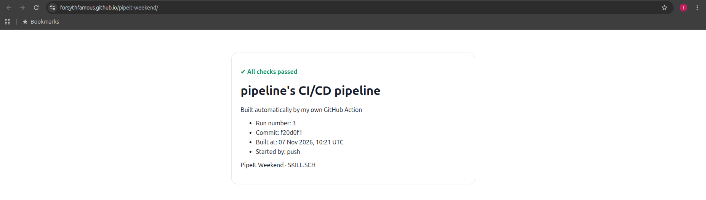
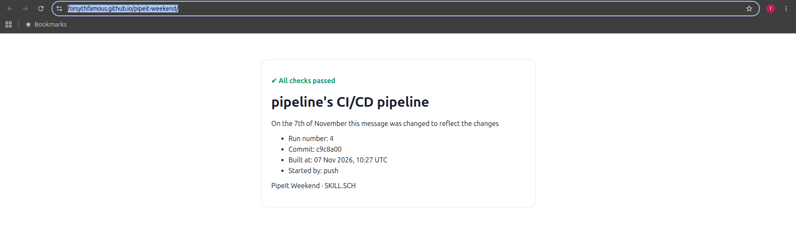
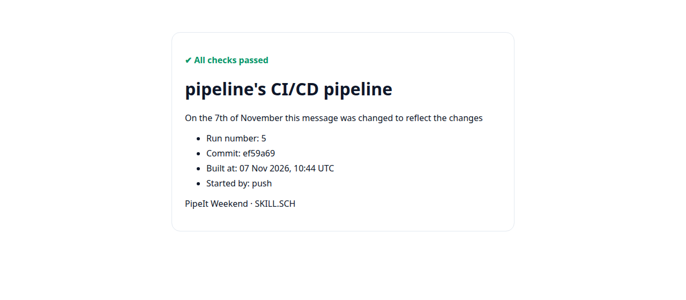
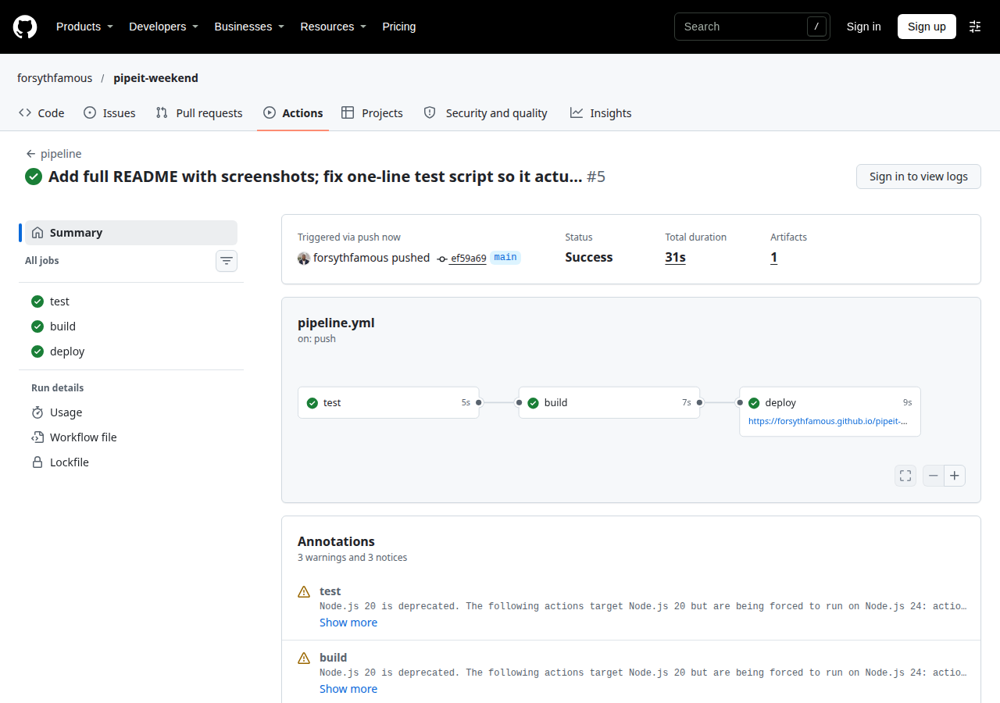
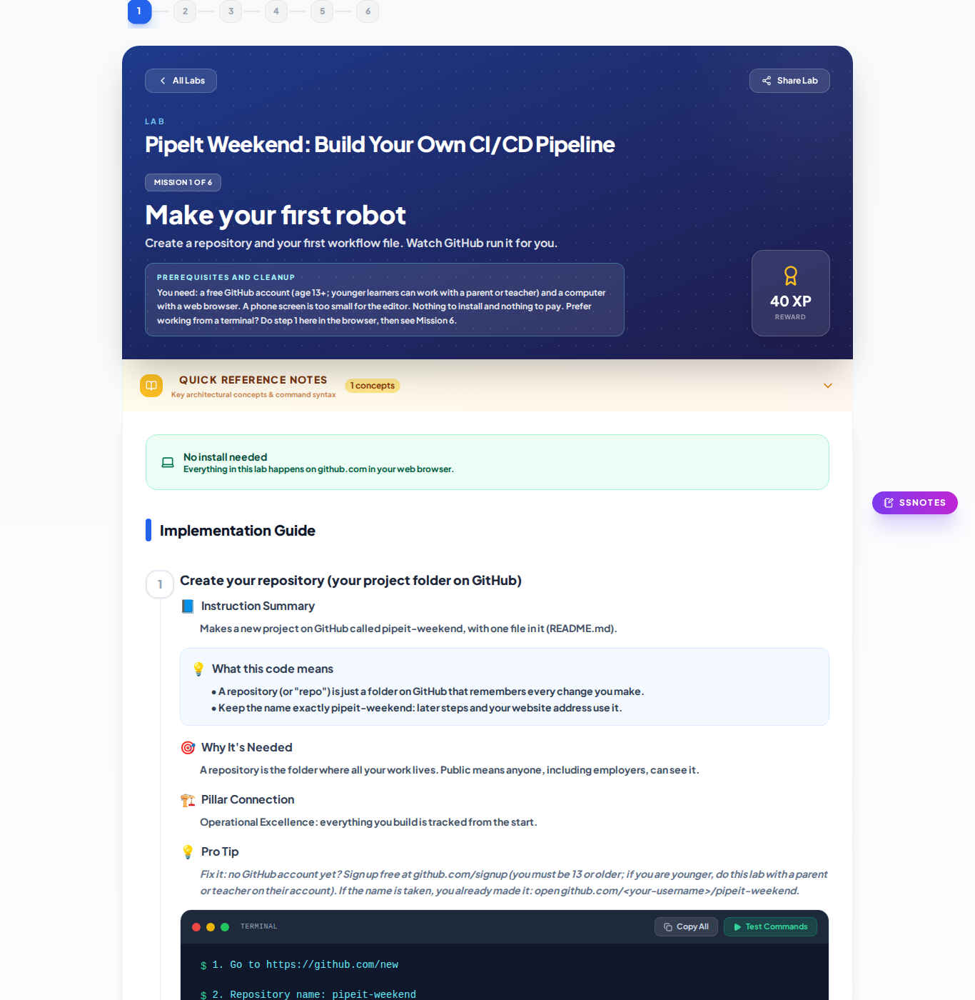

# PipeIt Weekend: CI/CD pipeline with GitHub Actions


**Live site:** https://forsythfamous.github.io/pipeit-weekend/

A complete CI/CD pipeline built on GitHub Actions. Every push to `main` is tested, a status page is
built by a **custom composite GitHub Action**, and the result is deployed to GitHub Pages with no manual
steps. The pipeline also rebuilds itself every day at 08:00 UTC on a schedule and can be started by hand.

Built from the [PipeIt Weekend: Build Your Own CI/CD Pipeline](https://skill-sch.com/cloudlabs?lab=PipeIt%20Weekend%3A%20Build%20Your%20Own%20CI%2FCD%20Pipeline)
lab by SKILL.SCH.

---

## Contents

- [Live result](#live-result)
- [How it works](#how-it-works)
- [Repository layout](#repository-layout)
- [The workflows](#the-workflows)
- [The custom action: build-card](#the-custom-action-build-card)
- [The test](#the-test)
- [Run it yourself](#run-it-yourself)
- [Verification](#verification)
- [Issues found and fixed](#issues-found-and-fixed)
- [What I learned](#what-i-learned)
- [What I would add next](#what-i-would-add-next)

---

## Live result

The page below is generated by the pipeline itself. Nothing on it is written by hand: the run number,
commit, build time and trigger are filled in by GitHub Actions at build time.

**Run 3: first deploy with the default message**



**Run 4: changed the `message:` input in `pipeline.yml`, pushed, and the site updated by itself**



Between the two screenshots the only change was one line in `pipeline.yml`. The pipeline ran test,
build and deploy, and the live page picked up the new message, a new run number (3 → 4) and the new
commit (`f20d0f1` → `c9c8a00`). No manual deploy.

**Run 5: after fixing the test (see [Issues found and fixed](#issues-found-and-fixed)), deployed by the same pipeline**



**Run 5 in the Actions tab: test → build → deploy, all green, 31 s end to end**



---

## How it works

```
  push to main ──┐
  daily 08:00 UTC├──►  pipeline.yml
  Run workflow ──┘
                         │
                         ▼
               ┌───────────────────┐
               │ test              │  bash tests/check.sh
               │                   │  fails the run if README has no title
               └─────────┬─────────┘
                         │ needs: test
                         ▼
               ┌───────────────────┐
               │ build             │  uses: ./.github/actions/build-card
               │                   │  writes site/index.html
               │                   │  upload-pages-artifact (site/)
               └─────────┬─────────┘
                         │ needs: build
                         ▼
               ┌───────────────────┐
               │ deploy            │  deploy-pages → environment github-pages
               └─────────┬─────────┘
                         ▼
        https://forsythfamous.github.io/pipeit-weekend/
```

- **`needs:`** chains the jobs. If `test` fails, `build` and `deploy` never start, so a broken change
  can't reach the live site.
- **`concurrency: pages`** with `cancel-in-progress: true` means only the newest run deploys; an older
  run still in progress is cancelled.
- **`permissions:`** are scoped to this workflow: `contents: read`, plus `pages: write` and
  `id-token: write` so `deploy-pages` can publish using GitHub's OIDC token. No stored secrets.

---

## Repository layout

| Path | Purpose |
|------|---------|
| `.github/workflows/hello.yml` | First workflow. Runs on every push and on demand; prints a message and the date. |
| `.github/workflows/pipeline.yml` | The CI/CD pipeline: test → build (custom action) → deploy to GitHub Pages. |
| `.github/actions/build-card/action.yml` | Custom composite action that builds the status page and writes a run summary. |
| `tests/check.sh` | The test: passes only if `README.md` starts with a `# ` title line. |
| `docs/screenshots/` | Evidence screenshots used in this README. |

---

## The workflows

### `hello.yml`

```yaml
on:
  push:
  workflow_dispatch:
```

The smallest useful workflow: proves Actions is wired up. `workflow_dispatch` adds a **Run workflow**
button in the Actions tab.

### `pipeline.yml`

| Trigger | When it fires |
|---------|---------------|
| `push` (branch `main`) | Every commit to `main` |
| `schedule: '0 8 * * *'` | Every day at 08:00 UTC, even with no commits |
| `workflow_dispatch` | Manually, from the Actions tab or `gh workflow run pipeline` |

The **Started by** line on the live page shows which of these triggered the build (`push`,
`schedule` or `workflow_dispatch`).

| Job | Depends on | What it does |
|-----|-----------|--------------|
| `test` | none | Checks out the repo and runs `bash tests/check.sh` |
| `build` | `test` | Runs the `build-card` action, then packages `site/` with `actions/upload-pages-artifact` |
| `deploy` | `build` | Publishes the artifact with `actions/deploy-pages` to the `github-pages` environment |

---

## The custom action: build-card

`build-card` is a **composite action**: a reusable list of ordinary shell steps, kept in this repo and
called with a local path.

```yaml
- name: Build my status card with my own action
  uses: ./.github/actions/build-card
  with:
    name: pipeline
    message: On the 7th of November this message was changed to reflect the changes
```

| Input | Required | Default | Used for |
|-------|----------|---------|----------|
| `name` | yes | none | Page heading and `<title>` |
| `message` | no | `Built automatically by my own GitHub Action` | Line under the heading |

| Output | Value |
|--------|-------|
| `page` | `site/index.html` |

What it does:

1. **Make the web page.** Writes `site/index.html` from a heredoc, filling in `$NAME`, `$MESSAGE`,
   `$GITHUB_RUN_NUMBER`, the short commit `${GITHUB_SHA::7}`, the UTC build time and
   `$GITHUB_EVENT_NAME`. Inputs are passed through `env:` rather than pasted straight into the script,
   which keeps user input out of the shell command itself.
2. **Write a run summary.** Appends to `$GITHUB_STEP_SUMMARY`, so every run page shows
   "✅ Status card built" with the run number and commit.

---

## The test

```bash
#!/usr/bin/env bash
# My first test. It passes only if README.md has a title line starting with "# ".
set -e

if grep -q "^# " README.md; then
  echo "✅ README has a title"
else
  echo "❌ README.md needs a title line that starts with # "
  exit 1
fi
```

`exit 1` fails the `test` job. Because `build` has `needs: test`, a failing test stops the deploy.
That's why the first line of this README has to stay a `# ` heading.

---

## Run it yourself

Prerequisites: Git and the [GitHub CLI](https://cli.github.com), signed in with `gh auth login`.

```bash
git clone https://github.com/forsythfamous/pipeit-weekend.git
cd pipeit-weekend

# Run the test locally before pushing
bash tests/check.sh

# Change the message, check the diff, ship it
nano .github/workflows/pipeline.yml       # edit the message: line
git diff
git commit -am "Change the status page message"
git push

# Watch the pipeline from the terminal
gh run list --workflow pipeline -L 5
gh run watch                              # pick the newest run
gh run view --log-failed                  # only if something went red

# Or start it by hand without a commit
gh workflow run pipeline
```

To use this in your own fork: switch on **Settings → Pages → Source: GitHub Actions**, and change
`name:` in `pipeline.yml` to your own name.

---

## Verification

Checked on **7 Nov 2026** with Playwright (headless Chromium) and the GitHub CLI:

| Check | Result |
|-------|--------|
| Live site `https://forsythfamous.github.io/pipeit-weekend/` | HTTP 200, title `pipeline's pipeline` |
| Page content before this README | Run 4, commit `c9c8a00`, built 07 Nov 2026 10:27 UTC, started by `push`, custom message shown |
| Page content after this README was pushed | Run 5, commit `ef59a69`, built 07 Nov 2026 10:44 UTC: site updated by itself |
| Test really runs in CI (after fix) | `Run my checks` log prints `✅ README has a title` |
| `pipeline` workflow runs | Latest runs `success` (test → build → deploy) |
| `hello` workflow runs | Latest runs `success` |
| Pages source | `build_type: workflow` (GitHub Actions) |
| Lab checklist (Mission 5 credential checks) | Workflows in `.github/workflows` ✔, custom `action.yml` used by a workflow ✔, daily schedule ✔, green run ✔, live site built by the action ✔ |

Lab reference (Mission 1 page, captured by Playwright):

<details>
<summary>Show screenshot</summary>



</details>

---

## Issues found and fixed

Verifying the repo against the lab turned up three things worth recording.

1. **The test never actually ran.** `tests/check.sh` had been committed as a single line. Everything after
   `#!/usr/bin/env bash` was on the shebang line, so bash read the whole script as a comment and always
   exited 0. The CI log for the `Run my checks` step printed nothing at all. Meanwhile the old README's
   first line was `#$ pipeit-weekend`, which has no `# ` title, so a working test would have failed it.
   The "✔ All checks passed" on the page was true only because nothing was checked.
   **Cause:** the lab page shows the `check.sh` snippet with its line breaks lost, so copying it gives a
   one-line file. **Fix:** rewrote the script on separate lines (above) and gave this README a real title.
   The test now prints `✅ README has a title` in CI.
2. **`ci.yml` was saved at the wrong path.** It was first created as
   `2. Name: .github/workflows/ci.yml` (the instruction text ended up in the file-name box), so GitHub
   never treated it as a workflow. It was later deleted. The test now runs as the first job of
   `pipeline.yml` instead, which still gates the deploy.
3. **Action versions differ from the lab.** This repo uses `actions/checkout@v4`,
   `actions/upload-pages-artifact@v3` and `actions/deploy-pages@v4`. The lab shows `@v7`, `@v5`
   and `@v5`. The older versions still pass, but every run now shows a *"Node.js 20 is deprecated"*
   warning on `test`, `build` and `deploy` (visible in the run 5 screenshot). Upgrading to the lab's
   versions is the next change.

---

## What I learned

- Workflows live in `.github/workflows/*.yml` and start from triggers: `push`, `pull_request`,
  `schedule` (cron, UTC) and `workflow_dispatch`.
- `needs:` turns separate jobs into an ordered pipeline, and a failed job stops everything after it.
- How to write a composite action with inputs and outputs, and call it from the same repo with
  `uses: ./path`.
- GitHub Pages can deploy straight from a workflow artifact, using the run's OIDC token
  (`id-token: write`) instead of a stored secret.
- **A green tick only means as much as the test behind it.** A test that can't fail looks exactly like
  one that passes. It's worth breaking it on purpose once to see it go red.

## What I would add next

- [ ] Run `tests/check.sh` on pull requests too, and protect `main` so only green changes merge
- [ ] Lint YAML and shell (`actionlint`, `shellcheck`) as a second test job
- [ ] Add a post-deploy smoke test that fetches the live URL and checks the new run number is served
- [ ] Pin third-party actions to commit SHAs
- [ ] Publish `build-card` as a standalone action so other repos can use it

---

Built by [@forsythfamous](https://github.com/forsythfamous) during [PipeIt Weekend](https://skill-sch.com/pipeit) by SKILL.SCH.
